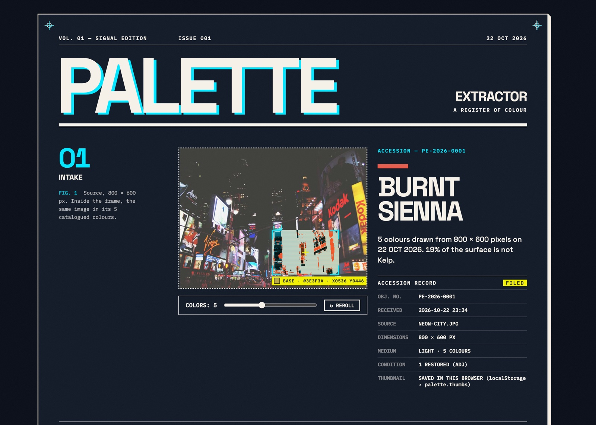
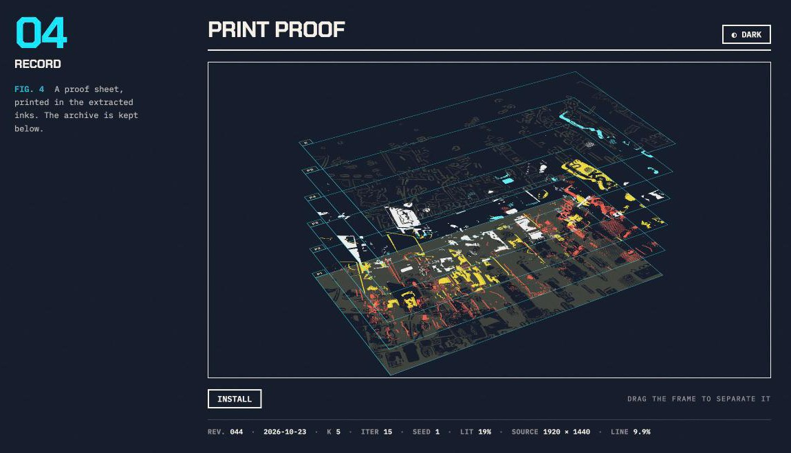

# Palette Extractor

**Turn an image into a role-based UI palette, with contrast checks and ready-to-export tokens.**

**English** | [简体中文](README.zh-CN.md)

[Try it live](https://palette.etarc.net) · Browser-side processing · No runtime dependencies or build step



## Why this exists

The most common colours in a photograph are not necessarily the most useful colours for an interface. A dark street can occupy almost the entire image while a small neon sign gives it its identity. A palette dominated by near-black shades can describe the pixels well and still miss what makes the image recognisable.

Even a good set of swatches leaves work to do: choose a background, find readable text, identify a primary colour, and turn those decisions into design tokens.

Palette Extractor connects those steps. It selects 3–8 colours using perceptual clustering and saliency, assigns them UI roles, repairs contrast for text and primary against the background, and exports the result for implementation. Extraction is deterministic for the same pixel input, colour count and seed.

## From image to interface

1. **Deposit an image.** Drop, paste or choose a file, use a sample, or select a region of the image.
2. **Inspect the palette.** Each colour has a role such as BASE, TEXT, PRIMARY or ACCENT, with hex and OKLCH values. Adjusted and generated colours are marked.
3. **Check relationships.** Inspect the WCAG contrast-ratio or APCA matrix, preview colour pairs as type, and simulate protan, deutan and tritan colour vision deficiencies with collision warnings.
4. **Export.** Download CSS variables with light/dark variants and hex fallbacks for OKLCH, a Tailwind configuration with 50–950 tonal scales, Figma token JSON, or a PNG cover. Palettes can also be shared by link, archived and starred.

Light/dark variants belong to the exported palette and proof preview; the Signal Edition interface has one fixed appearance.

## How it works

```text
Image / selected region
  → colour histogram + saliency map
  → seeded OKLab k-means candidates
  → greedy palette selection
  → UI role assignment
  → contrast repair
  → relationship checks, proof and exports
```

### Preserve the small colours that matter

The extractor builds a frequency-tuned saliency map adapted to OKLab. Saliency increases clustering weights for visually conspicuous regions. Rather than asking k-means for exactly the final number of colours, it first builds up to `2k + 4` candidates.

A greedy selector then chooses `k` candidates by balancing image coverage with conspicuity and colour separation. This gives a small vivid feature a chance to take a slot that would otherwise go to another similar background shade. Cluster representatives are snapped to colours present in the analysed image pixels.

**A concrete regression case:** the colour tests construct a scene containing five dark shades and a magenta light covering about 1% of the image. With only three output colours, the selector retains a colour near that light across seeds 1–8. This is a repeatable synthetic check; real photographs are inspected separately in the regression gallery.

### Give each colour a job

Role assignment scores permutations of the selected colours using area, lightness, chroma and relationships between roles. With at most eight colours, exhaustive search evaluates at most 40,320 assignments. The objective favours a broad, calm background, readable text and a vivid primary; additional roles depend on the requested palette size.

TEXT and PRIMARY are then checked against BASE, with target contrast ratios of **4.5:1** and **3:1** respectively. Repair moves OKLCH lightness while preserving hue, reducing chroma when necessary. The `ADJ` marker records a repair. If the source contains too few distinct colours, derived colours fill the missing roles and receive a `GEN` marker.

Extracted representatives therefore come from the image; repaired colours, generated fills and export derivatives can differ from it. The checks cover specific colour relationships, rather than certifying the accessibility of a finished interface. APCA is available as an additional inspection model; automatic repair uses WCAG contrast ratios.

### Keep pixel work off the interface thread

Colour analysis and print-proof rendering use Web Workers. The colour engine has no DOM dependency and is shared by the application, regression gallery and Node tests. Seeded clustering supports repeatable output, while REROLL explores another seed.

The site is static HTML, CSS and JavaScript. Images are analysed in the browser without an image-processing server. Archive entries, favourites and source thumbnails are stored locally in the browser; thumbnails can be cleared from the page.

## Validation

The project checks colour behaviour, image-processing edge cases and browser interactions separately:

| Check | What it exercises |
| --- | --- |
| Colour unit tests | Colour-space round trips, known-colour recovery, deterministic output, role assignment, contrast repair, salient accents and extreme inputs |
| Proof unit tests | Ink separation, plate stacking, cut-outs and rendering edge cases |
| Regression gallery | 15 real-world images plus synthetic cases; saved baselines highlight changed role colours and compare mean OKLab reconstruction error |
| Browser edge checks | Ten extreme images through the actual page in Chromium and WebKit, including transparent, one-pixel and 8000 px inputs, with proof and export checks |
| Reference screenshots | Desktop and iPhone layouts, with reduced motion and a fixed clock for repeatable comparisons |
| Performance tooling | Cold-load measurements and sample-to-palette/proof timing under desktop and throttled CPU/network profiles |

The gallery is a development corpus for inspecting tradeoffs. Reconstruction error measures colour fidelity; it does not measure whether someone prefers a palette.

## Design: Signal Edition

The interface treats an image as an object catalogued in a magazine register: received, measured, proofed and filed. A strict grid, a blue-black sheet and restrained signal marks keep extracted colours prominent. The design rules and motion constraints are documented in [DESIGN.md](DESIGN.md).

- **Intake:** the source image, animated clustering and a lens showing the local colour and its assigned role.
- **Specimen:** role-labelled swatches, OKLCH values and export controls.
- **Relations:** contrast matrices, type previews and colour vision simulations.
- **Proof:** a cel-style rendering in the palette's inks, separated into one plate per ink plus a K plate for line work. EJECT pulls the stack apart. Before an image is deposited, a test card uses the current palette.



The [Classic edition](https://palette.etarc.net/classic), built in April 2026, is preserved separately. It shares archive and favourites with Signal Edition but keeps its own frozen algorithm, UI and styles.

## Run locally

Serving the application requires no install or build step:

```sh
python3 -m http.server
# Open http://localhost:8000
# Regression gallery: http://localhost:8000/gallery.html
```

Run the Node unit tests:

```sh
npm test
node --test test/color.test.js
node --test test/proof.test.js
```

Browser tooling uses Playwright as a development dependency:

```sh
npm install
npx playwright install chromium webkit
npm run edge
npm run perf
```

`npm run perf` targets the live site by default. To measure the local server, use `npm run perf -- http://localhost:8000`.

For a visual change, capture a baseline before editing, then compare:

```sh
npm run shots -- before/
# Make the visual change
npm run shots -- after/
npm run compare -- before/ after/
```

Screenshots use reduced motion and a fixed clock. The comparison writes `diff-*.png` into the second directory. To capture the live site, use `URL=https://palette.etarc.net/ npm run shots -- live/`; network-decoded images may introduce small differences.

To review an algorithm change, open `gallery.html`, choose a colour count and seed, save a baseline, then refresh after editing. Changed role colours are outlined, with the previous palette shown alongside them.

## Files

| File | Purpose |
| --- | --- |
| `color.js` | All colour logic (OKLab, k-means, roles, contrast, CVD, APCA). No DOM. |
| `main.js` | The app UI (panels, exports, history) |
| `index.html` | Magazine edition (homepage) |
| `register.css` / `register.js` | Accession record and the colour plates under the sheet |
| `edition.css` / `edition.js` | Magazine layout, colour tokens, Fig. 1 lens, press marks |
| `DESIGN.md` | Design rules: tokens, principles, rejected directions, working agreement |
| `classic.html`, `color-classic.js`, `main-classic.js`, `style-classic.css` | The original page, frozen: its own copies of the algorithm, the UI and the styles |
| `proof.js` / `proof-worker.js` | Fig. 4 print proof: framing, plates, test card (page); cel, tones, lines, separation (worker) |
| `previews.js`, `cover.js` | Archive/matrix previews; magazine-cover export |
| `follow.js`, `fx.js`, `pagefx.js` | Cursor follow, screen-signal effects, page events (title cards, Sandevistan, press run) |
| `samples.js`, `samples/` | Six sample photographs under Fig. 1 (1920 × 1440), with 256 px thumbnails in `samples/thumbs/` |
| `fonts/` | Chakra Petch, Space Grotesk, IBM Plex Mono (OFL), self-hosted: Latin + Latin Extended, `fonts/fonts.css` |
| `style.css` | Base styles and the panels |
| `gallery.html` / `gallery.js`, `regression/` | Regression gallery (development tool; not indexed) |
| `test/` | `npm test`: colour logic and the proof worker |
| `tools/` | Browser tooling (Playwright): `edge`, `perf`, `shots`, `compare` — see Tests |
| `package.json` | Dev tooling only; the site has no build step |
| `ntc.js` | Colour naming ("Name that Color") |
