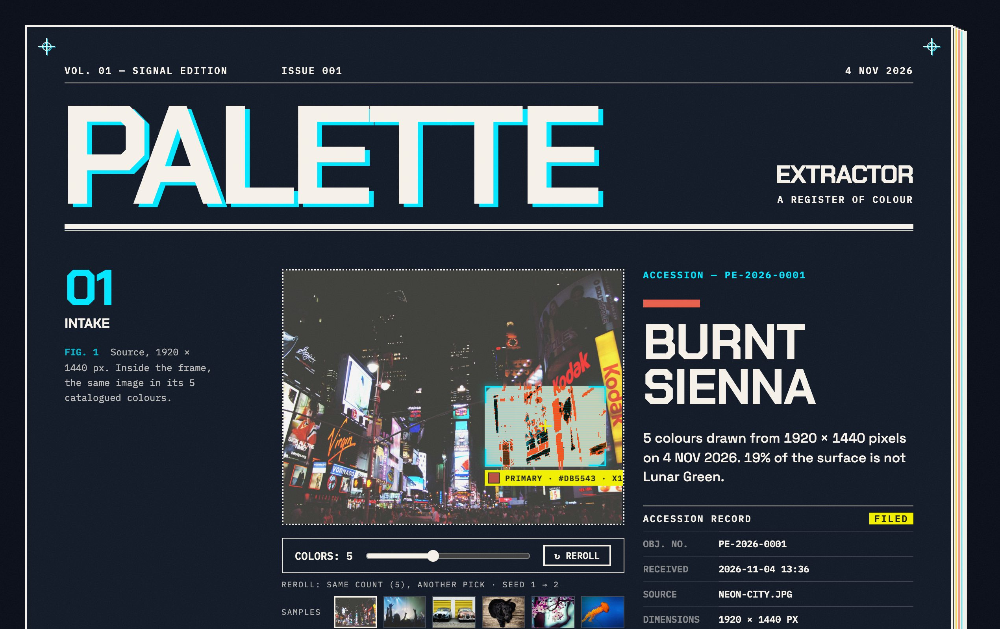
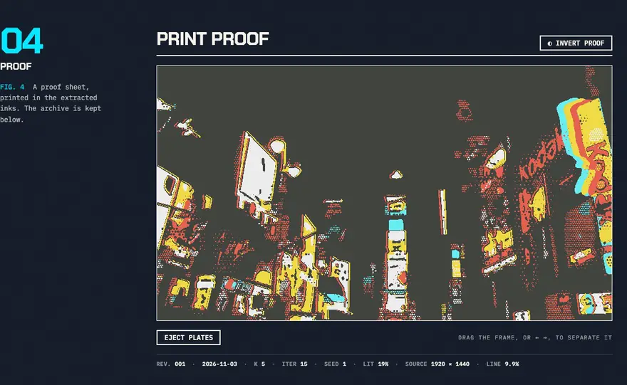

<div align="center">

# Palette Extractor

[](https://github.com/Ian9657/palette_extractor/actions/workflows/test.yml)
[](LICENSE)

**English** | [简体中文](README.zh-CN.md)

Extracts a 3–8 colour UI palette from an image, assigns each colour a role (`BASE`, `TEXT`, `PRIMARY`, …), repairs text/primary contrast, and exports CSS, Tailwind and Figma tokens.

[palette.etarc.net](https://palette.etarc.net) · static HTML/CSS/JS, no build step, no runtime dependencies · images never leave the browser



</div>

## Pipeline

```text
image ─ own JPEG decode, area average to 400 px
      ─ saliency map + 15-bit histogram        page thread
      ─ k-means, 2k+4 candidates               Web Worker
      ─ greedy selection of k                  Web Worker
      ─ role search · contrast repair · fills  page thread
      ─ CSS / Tailwind / Figma / PNG export
```

All of it is in `js/color.js`, which has no DOM dependency: the page loads it as a script, the k-means half is stringified into a Worker, and the Node tests `require` it.

### 1. Histogram and saliency

The image is read at a longest side of at most 400 px (see [Same file, same record](#same-file-same-record)). Pixels with alpha < 128 are dropped. Each remaining pixel goes into one of 32,768 bins (5 bits per channel); a bin stores the mean RGB of its pixels, not the bin centre, so reported colours exist in the image.

Saliency is frequency-tuned (Achanta et al. 2009) in OKLab: each channel is box-blurred twice with radius `min(w, h) / 160`, and a pixel's saliency is its distance from the image mean, with `a`/`b` scaled by 2.5 so chroma counts more than lightness. Values are normalised by the 99th percentile. Each bin carries the mean saliency of its pixels.

### 2. Candidates: k-means

Bins are clustered in OKLab with k-means++ seeding from a seeded PRNG (mulberry32), weight `count × (1 + 3·saliency)`, at most 15 iterations. The worker posts every iteration and the page replays them at 60 ms per frame, which is the scan animation.

It asks for `2k + 4` clusters instead of `k`. Before the last two iterations, any two centroids closer than 0.07 are merged and the smaller one is reseeded on the bin with the highest `distance to other centroids × min(chroma weight, 3) × log(1 + count)`. At the end, every centroid snaps to the nearest real bin in its cluster.

### 3. Selection

From the `2k + 4` candidates, `k` are picked greedily, maximising

```text
F(S) = coverage(S) + λ · Σ distinct(j) · vivid(j) / max vivid      λ = 0.1
```

- **coverage**: facility location. Each pixel is covered by its most similar chosen colour, `sim = max(0, 1 − d/τ)`, τ = 0.2 OKLab, weighted by pixel count. It is monotone submodular, so greedy is within `1 − 1/e` of the optimum on this term.
- **vivid(j)**: mean over the cluster of `saliency × standOut`, where `standOut = max(min(1, C/0.15), 0.6 · min(1, |L − L̄| / 0.35))`. It is a mean, not a sum, so area stays coverage's job. Clusters under 0.2 % of pixels score 0.
- **distinct(j)**: `min(1, d_nearest / 0.25)`, using the same chroma-weighted distance (×2.5). It keeps near-duplicate dark shades from filling slots.

The terms follow Lin & Hanrahan (CHI 2013). In practice, a 1 % neon sign can take a slot from a fourth near-black.

### 4. Roles

Roles per `k` are fixed tables (`ROLE_NAMES` / `ROLE_KEYS` in `color.js`; for k = 5: `BASE SECOND PRIMARY ACCENT TEXT`). Assignment is an exhaustive permutation search, at most 8! = 40,320 leaves. Each role is scored by named terms in OKLCH, for example:

| Role | Score terms |
| --- | --- |
| `bg` | `log(area)` − 8C + 1.5·\|L − 0.5\| |
| `text` | 1.5·log(contrast vs bg) − 2C |
| `primary` | 8C + 0.2·log(area) |
| `accent` | 2C + 3·hue distance from primary |

The terms are kept separate so `gallery.html` can show why a colour won a role.

### 5. Contrast repair and fills

`TEXT` must reach 4.5:1 against `BASE` and `PRIMARY` 3:1 (WCAG 2 ratio). A failing colour is moved along OKLCH lightness in 0.01 steps, trying the nearer extreme first with hue and chroma kept, then again with chroma fading toward 0. The original hex is kept, and the swatch is marked `ADJ`.

If the image has fewer distinct colours than `k`, the missing ones are derived from the dominant and the most chromatic colour (an ink for text, a surface step, the complement, lighter and darker steps). Candidates within 0.05 OKLab of an existing colour are skipped. These are marked `GEN`.

### 6. Inspection and export

- WCAG ratio or APCA (0.0.98G-4g) matrix for every pair.
- CVD simulation: Machado et al. 2009 at severity 1.0, in linear sRGB. Warnings when `primary`/`accent`/`secondary`/`highlight` pairs collapse.
- CSS variables with light and dark sets (hex plus `oklch()` overrides) and a Tailwind config with an 11-step scale (50–950: OKLCH L 0.97 → 0.24 at the source hue, chroma tapered away from L 0.6).
- Figma token JSON, a 1200 × 1500 PNG cover, and a share link `#p=HEX-HEX-…` in role order.

## 04 Proof



The proof re-renders the photo using only the palette's inks, as cel animation, and separates it into one plate per ink plus a K (line) plate. Every pixel is on exactly one plate.

`js/proof.js` (page) picks a 16:9 cut that follows the saliency map, and draws the frame. Sources under 480 px are shown whole, at 80 %. The working copy is at most 1024 px wide, sent once per image to `js/proof-worker.js`. The worker caches the analysis per image + palette and returns one RGBA buffer per plate. Stale replies are dropped by job id. Analysis steps:

| Step | Method | Parameters |
| --- | --- | --- |
| cels | guided filter on L (He et al. 2010), 2 passes, then nearest ink; patches below a minimum merged into neighbours | r = 5 px at 960 w, ε = 0.0025, min patch 0.04 % |
| shadow | one hard step into the next darker ink | ΔL 0.07 |
| tone | halftone dots on a 4 px grid, dot area = lift toward the next lighter ink | area ≤ 0.5 |
| lines | cel boundaries where inks differ, plus DoG edges kept only as strokes | ΔE > 0.08, DoG < −0.012, stroke ≥ 30 px |
| echoes | 3 offset copies of the most salient subject (skipped if it fills > 45 % of the width) | gap ≥ 14 px at 960 w |

Plates stack by area: the largest at the bottom, K on top. EJECT, drag, or ←/→ moves them through 6 positions.

## Same file, same record

The palette is a pure function of the pixels, the colour count and the seed. Getting the same pixels out of a file is the harder part. Measured between Chromium and WebKit on the 21 images in `samples/` and `regression/`:

| Layer | Difference | Same colours and roles (k = 3, 5, 8, seed 1) |
| --- | --- | --- |
| `drawImage` to 400 px | up to 198 levels on a channel | 24 / 63 |
| browser JPEG decode, own downscale | mean 0.01–0.43, up to 32 | 28 / 63 |
| `js/decode.js` for both | 0 | 63 / 63 |

k-means turns those small differences into different palettes, and no change to the clustering fixed that: fixed per-bin random draws, density-peak candidates and swap search all stopped near 44 / 63. So the input is what is made identical.

`js/decode.js` is a JPEG decoder in integer arithmetic: baseline and progressive, any chroma subsampling, restart markers, EXIF orientation, and matrix-shaper ICC profiles such as Display P3 converted to sRGB. Against Chromium's decoder it differs by a mean of 0.02–0.05 levels. At 8× the reading size and above (`max(w, h) ≥ 3200`), each block's DC term stands in for its pixels, so a 48 MP file needs no 192 MB canvas. All images are then downscaled by area average, weighted by alpha.

Timings in V8 on Apple Silicon, on a sample photo upscaled and saved at quality 95: 12 MP in 88 ms, 48 MP in 149 ms, 7.7 MP (the slowest case, full IDCT) in 231 ms. Against drawImage in Chromium, mean OKLab reconstruction error moves from 0.0499 to 0.0502.

The record shows the result as `CHECKSUM`, FNV-1a of the 400 px pixels. Two browsers showing the same checksum read the same image.

Limits:

- PNG decodes identically in both engines, so it stays with the browser, as do formats this decoder declines: WebP, CMYK, 12-bit, arithmetic coding and LUT ICC profiles. WebP and these JPEGs are not covered by the guarantee.
- Only the palette is covered. The 04 proof still draws from the browser's decoded image, so its picture can differ slightly between browsers; its inks do not.
- These runs use Playwright's WebKit build, not Safari itself. Because the decoder doesn't use the browser's, Safari should match, but that has not been checked on a device yet.

Same pixels + same `k` + same seed → the same palette. REROLL increments the seed.

## Storage

Nothing is uploaded. `localStorage` keys: `paletteHistory` (last 8), `starredPalettes`, `palette.thumbs` (240 px source thumbnails, clearable from the page), `contrastModel`, `accessionCount`, `proofRevCount`.

## Tests and tools

```sh
npm test            # node --test: 79 tests, ~30 s, no install needed
```

`test/color.test.js` covers conversions, known-colour recovery, seeded determinism, roles, contrast repair, saliency selection and fills. `test/proof.test.js` runs `proof-worker.js` in a `vm` with an `importScripts` shim. `test/decode.test.js` reads 20 JPEG variants in `test/fixtures/` (generated by `tools/make-jpeg-fixtures.py`) and holds every JPEG in the repo to its checksum and palettes in `test/records.json`. CI runs `npm test` on every push to `main`.

Browser tools (`npm install && npx playwright install chromium webkit`):

| Command | Does |
| --- | --- |
| `npm run edge` | 10 synthetic inputs (1 × 1, 40 × 3000, 8000 × 6000, fully transparent, …) through the real page in Chromium and WebKit |
| `npm run cross` | every image at k = 3, 5, 8 and seeds 1–3 in Chromium and WebKit, compared with each other and with `test/records.json`; the six samples through the real page; an 8000 × 6000 JPEG timed |
| `npm run perf` | cold load, sample → palette, sample → proof, at desktop speed and throttled CPU/network |
| `npm run shots -- dir/` | desktop and iPhone screenshots with reduced motion and a fixed clock |
| `npm run compare -- a/ b/` | pixel diff of two shot sets |

`gallery.html` runs the 15 images in `regression/` plus synthetic cases. For each, it shows roles, score terms and mean OKLab reconstruction error against a saved baseline.

## Run locally

```sh
python3 -m http.server     # http://localhost:8000, /gallery.html
```

## Layout

```text
index.html  classic.html  gallery.html     pages (URLs unchanged: /, /classic, /gallery)
icon.svg  apple-touch-icon.png  og-image.png  CNAME
css/        style.css, register.css, edition.css  · style-classic.css (frozen)
js/         color.js        colour engine, worker bootstrap
            decode.js       JPEG decoder, area downscale, checksum
            main.js         page state, extraction calls, history, exports
            proof.js        04 proof framing and drawing
            proof-worker.js 04 pixel work (Worker)
            edition.js, register.js, pagefx.js, fx.js, follow.js   Signal Edition layout and motion
            previews.js, samples.js, cover.js, gallery.js, ntc.js
            *-classic.js    frozen Classic Edition
fonts/      self-hosted woff2 + fonts.css + OFL.txt
samples/    6 sample photos (1920 px) + thumbs/ (256 px)
regression/ 15 gallery images + list.js
test/       node --test suites, fixtures/, records.json
tools/      Playwright tools (edge, perf, shots, compare) + static server
docs/       DESIGN.md (tokens, grid, type, motion rules) and README images
```

## License

Code: MIT ([LICENSE](LICENSE)). `ntc.js` (Name that Color, Chirag Mehta) is CC BY 2.5; the fonts are SIL OFL 1.1 ([fonts/OFL.txt](fonts/OFL.txt)); the sample and regression photographs are from Unsplash under the Unsplash License. See [NOTICE](NOTICE).
