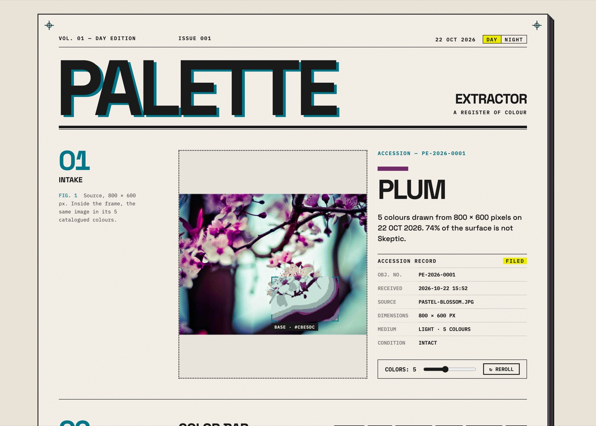
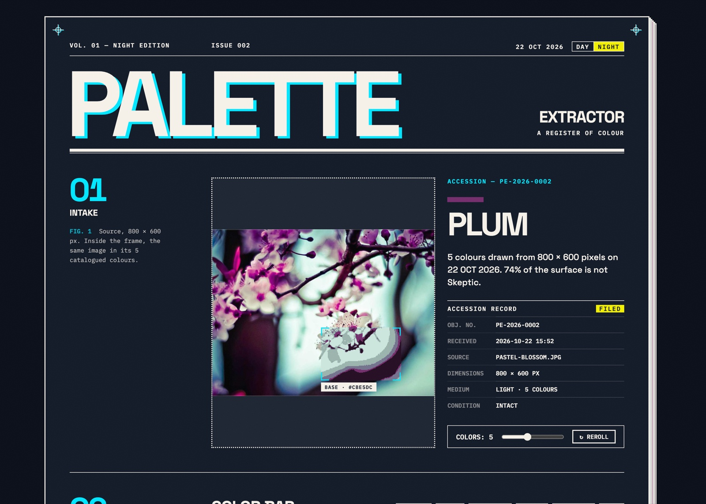

# Palette Extractor

**Photo in, usable UI theme out.** Drop or paste an image and get a palette where every colour has a job — background, text, primary, accent — with contrast already checked.

Live: [palette.etarc.net](https://palette.etarc.net)

| Day edition | Night edition |
| --- | --- |
|  |  |

## Editions

The homepage is laid out like a magazine feature about the image you deposit: a masthead, an opener whose headline is the name of the photo's primary colour, then numbered figures for the palette, its contrast relations, a print proof and the archive.

- **Day / Night.** One layout, two sets of colour tokens: warm paper and ink by day, Night City blue-black with a cyan signal by night. Your choice is remembered. Only the interface changes — photos, swatches and every computed value stay as extracted.
- **The lens.** In Fig. 1 the original photo is shown; a small frame drifts across it (or follows your mouse) and shows the same spot in its catalogued colours, with the role it belongs to.
- **Press marks.** Registration marks at the corners, a specimen strip of the current palette in the margin, and the OKLCH value of every swatch.
- **Classic edition.** The original page is kept at [palette.etarc.net/classic](https://palette.etarc.net/classic). Both editions share the same archive and favourites.


## What makes it different

- **Roles, not just swatches.** Colours are assigned to roles (BASE, TEXT, PRIMARY, ACCENT…) by scoring every possible assignment, so the background is the largest calm colour and the primary is the most vivid one.
- **Contrast repair.** If TEXT or PRIMARY is too faint against BASE, only its lightness is moved (hue kept), and the swatch says it was adjusted.
- **Real colours only.** Clusters are computed in OKLab, then snapped to the nearest colour that actually exists in the image — no averaged mud.
- **Accessibility built in.** WCAG 2.1 and APCA contrast matrix, protan/deutan/tritan simulation with collision warnings, one-click light/dark theme.
- **Reproducible.** Seeded k-means: same image + seed = same palette. REROLL tries the next seed.

## Features

- Drag & drop, paste (⌘/Ctrl+V), or drag a box on the image to extract from a region
- 3–8 colours, with the k-means iterations animated live
- Export: CSS variables (light + dark, hex with OKLCH fallback), Tailwind config with 50–950 scales, Figma tokens, PNG
- Shareable link, history and favourites (stored in your browser)

## Run locally

No build step, no dependencies.

```sh
python3 -m http.server
# open http://localhost:8000
```

## Tests

```sh
node --test test/color.test.js   # unit tests for the colour logic
```

`gallery.html` runs the extractor over 15 hard real-world images (`regression/`) plus synthetic cases. Save a baseline, change the algorithm, refresh — every role whose colour moved is outlined.

## Files

| File | Purpose |
| --- | --- |
| `color.js` | All colour logic (OKLab, k-means, roles, contrast, CVD, APCA). No DOM. |
| `main.js` | The app UI (panels, exports, history) — shared by both editions |
| `index.html` | Magazine edition (homepage) |
| `register.css` / `register.js` | Accession record and the colour plates under the sheet |
| `edition.css` / `edition.js` | Magazine layout, Day/Night tokens, Fig. 1 lens, press marks |
| `classic.html` | The original page |
| `style.css` | Base styles and the panels, used by both editions |
| `prototypes/` | Design steps between the two editions |
| `gallery.html` / `gallery.js` | Regression gallery |
| `ntc.js` | Colour naming ("Name that Color") |
