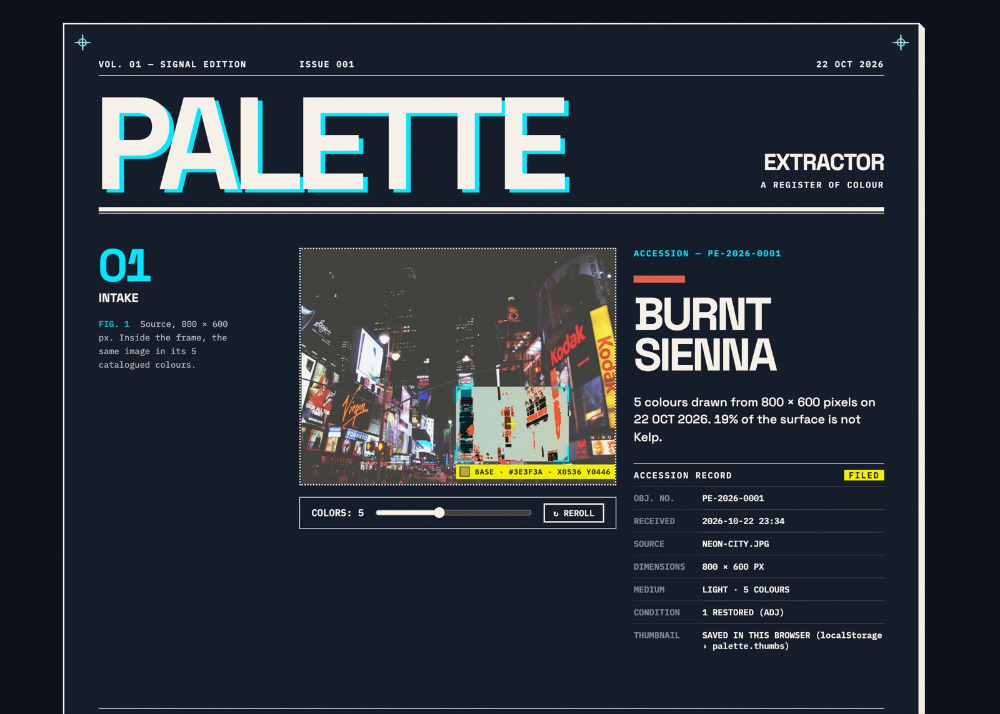
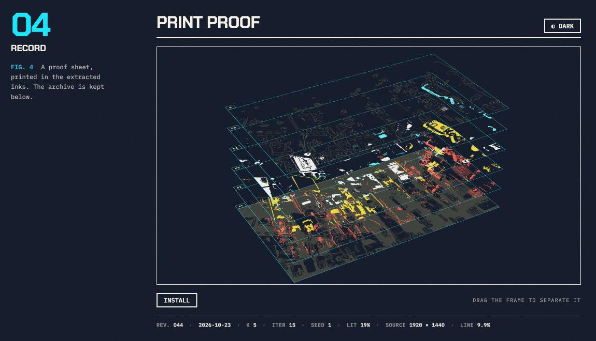
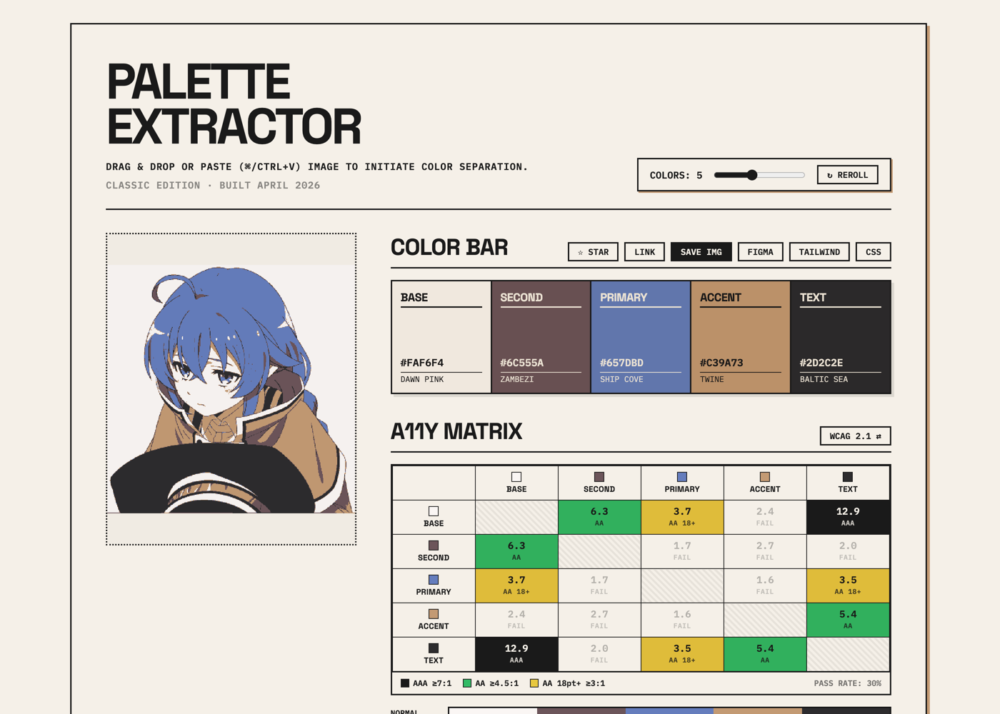

# Palette Extractor

**Photo in, usable UI theme out.** Drop or paste an image and get a palette where every colour has a job — background, text, primary, accent — with contrast already checked.

Live: [palette.etarc.net](https://palette.etarc.net)



## Editions

There are two editions: the **Signal Edition** (the homepage) and the **Classic edition** it grew out of.

The Signal Edition is laid out like a magazine feature about the image you deposit — a masthead, an opener whose headline is the name of the photo's primary colour, then numbered figures for the palette, its contrast relations, and a print proof with the archive — set on a Night City blue-black sheet with one cyan signal colour. The interface stays quiet so the extracted colours are always the loudest thing on the page. Design rules live in [DESIGN.md](DESIGN.md).

- **The lens.** In Fig. 1 the original photo is shown; a small frame drifts across it (or follows your mouse) and shows the same spot in its catalogued colours, with the role it belongs to.
- **Press marks.** Registration marks at the corners, a specimen strip of the current palette in the margin, and the OKLCH value of every swatch.
- **Print proof.** Fig. 4 redraws the photo as one anime cel in the palette's inks and separates it like a print job — one plate per ink plus a K plate for the lines. EJECT pulls the stack apart. With no photo yet it shows a test card: SMPTE colour bars in the palette's inks, NO SIGNAL DETECTED. The pixel work runs in a Web Worker, so the page never freezes.
- **Cover export.** SAVE IMG prints the current object as a 4:5 magazine cover.
- **Archive previews.** Hover an archived palette to see its source photo; hover a matrix cell for a type specimen of that pair. Thumbnails are kept only in your browser (localStorage `palette.thumbs`) and can be cleared from the page.
- **Classic edition.** The original page, built in April 2026, is kept at [palette.etarc.net/classic](https://palette.etarc.net/classic). Both editions share the same archive and favourites.





## What makes it different

- **Roles, not just swatches.** Colours are assigned to roles (BASE, TEXT, PRIMARY, ACCENT…) by scoring every possible assignment, so the background is the largest calm colour and the primary is the most vivid one.
- **Contrast repair.** If TEXT or PRIMARY is too faint against BASE, only its lightness is moved (hue kept), and the swatch says it was adjusted.
- **Real colours only.** Clusters are computed in OKLab, then snapped to the nearest colour that actually exists in the image — no averaged mud.
- **Small, vivid colours survive.** A frequency-tuned saliency map (Achanta et al., 2009) marks what catches the eye; the image is over-clustered into candidates, and the final palette is chosen by greedy submodular maximisation of coverage + conspicuity + diversity — the factors Lin & Hanrahan (2013) found people weigh when picking colour themes. A neon sign on a dark street now gets its slot instead of a fourth shade of grey. On the 15 regression images, recall of the most salient 2% of pixels rose from 84% to 97% with the same average fidelity error.
- **Accessibility built in.** WCAG 2.1 and APCA contrast matrix, protan/deutan/tritan simulation with collision warnings, one-click light/dark theme.
- **Reproducible.** Seeded k-means: same image + seed = same palette. REROLL tries the next seed.

## Features

- Drag & drop, paste (⌘/Ctrl+V), or drag a box on the image to extract from a region
- 3–8 colours, with the k-means iterations animated live
- Export: CSS variables (light + dark, hex with OKLCH fallback), Tailwind config with 50–950 scales, Figma tokens, PNG
- Shareable link, history and favourites (stored in your browser)

## Run locally

No build step, no dependencies.

```sh
python3 -m http.server
# open http://localhost:8000
```

## Tests

```sh
npm test                          # everything (~30 s); same as node --test
node --test test/color.test.js   # the colour logic, including extreme images
node --test test/proof.test.js   # the proof worker: plates, inks, stacking, cut-outs, edge cases
```

Browser checks need Playwright once: `npm install` (the browsers: `npx playwright install chromium webkit`).

```sh
npm run perf    # load time of the live site: desktop, mid phone, slow phone (CPU and network throttled)
npm run edge    # ten extreme images (white, black, 1 px, cut-out, fully transparent, 8000 px…) through the real page in Chromium and WebKit
npm run shots -- before/   # six reference shots (desktop 1400 + iPhone 13: empty, filed, proof apart) into before/ (default shots/)
npm run compare -- before/ after/   # what changed between two sets, with diff-*.png in after/
```

For a visual change: `npm run shots -- before/`, make the change, `npm run shots -- after/`, `npm run compare -- before/ after/`. Shots are taken with reduced motion and a fixed clock, so two local runs match pixel for pixel; against the live site (`URL=https://palette.etarc.net/`) network-decoded images can differ by a few hundred pixels.

`gallery.html` runs the extractor over 15 hard real-world images (`regression/`) plus synthetic cases. Save a baseline, change the algorithm, refresh — every role whose colour moved is outlined.

## Files

| File | Purpose |
| --- | --- |
| `color.js` | All colour logic (OKLab, k-means, roles, contrast, CVD, APCA). No DOM. |
| `main.js` | The app UI (panels, exports, history) — shared by both editions |
| `index.html` | Magazine edition (homepage) |
| `register.css` / `register.js` | Accession record and the colour plates under the sheet |
| `edition.css` / `edition.js` | Magazine layout, colour tokens, Fig. 1 lens, press marks |
| `DESIGN.md` | Design rules: tokens, principles, rejected directions, working agreement |
| `classic.html` / `color-classic.js` | The original page, with its original algorithm frozen |
| `proof.js` / `proof-worker.js` | Fig. 4 print proof: framing, plates, test card (page); cel, tones, lines, separation (worker) |
| `previews.js`, `cover.js` | Archive/matrix previews; magazine-cover export |
| `follow.js`, `fx.js`, `pagefx.js` | Cursor follow, screen-signal effects, page events (title cards, Sandevistan, press run) |
| `samples.js`, `samples/` | Six sample photographs under Fig. 1 (1920 × 1440) |
| `style.css` | Base styles and the panels, used by both editions |
| `gallery.html` / `gallery.js` | Regression gallery |
| `ntc.js` | Colour naming ("Name that Color") |
