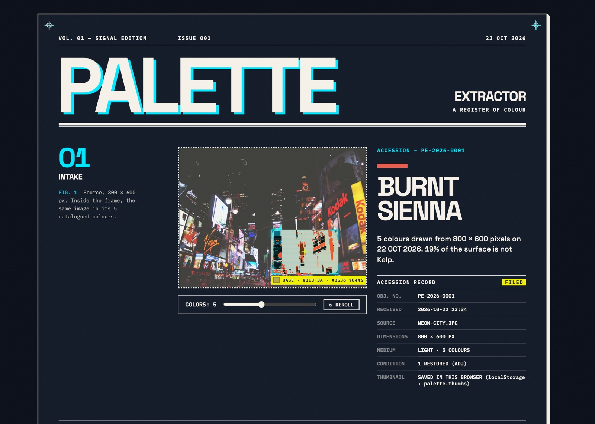
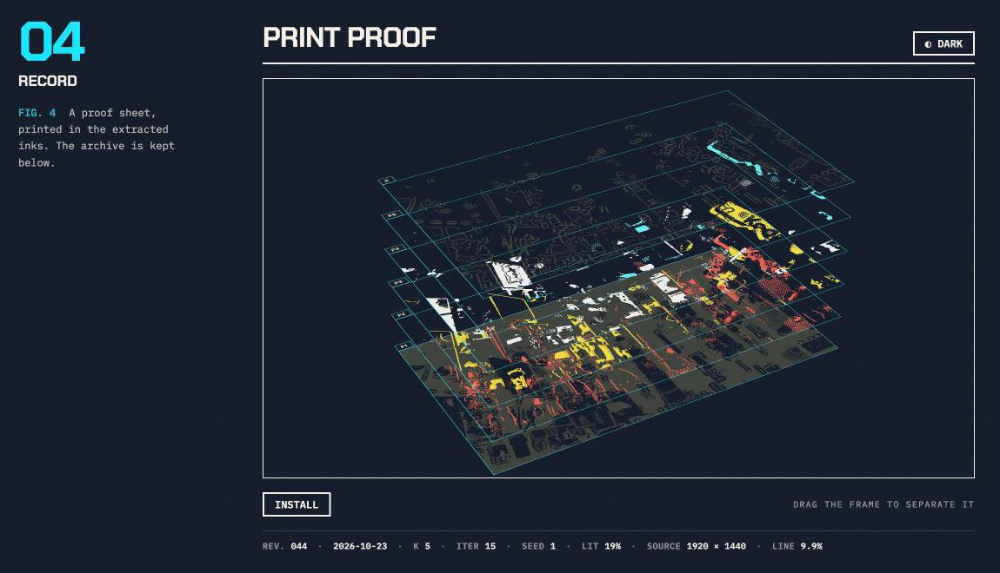

# Palette Extractor

**从图像生成具有 UI 角色、经过对比度检查、可直接导出的配色。**

[English](README.md) | **简体中文**

[在线体验](https://palette.etarc.net) · 浏览器本地处理 · 无运行时依赖，无需构建



## 为什么做这个

一张照片里占比最高的颜色，未必是界面最需要的颜色。夜景里的街道可能占据了绝大多数像素，一小块霓虹招牌却决定了整张照片的辨识度。提取出几种接近黑色的颜色，可以很好地还原像素分布，却可能丢掉最值得保留的强调色。

即使得到一组满意的色块，仍然需要决定：哪个做背景，哪个做正文，哪个做主色，它们放在一起是否清晰，以及如何转成项目里的设计 token。

Palette Extractor 把这些步骤连接起来：结合感知色彩空间和视觉显著性提取 3–8 种颜色，分配 UI 角色，修正正文和主色相对背景的对比度，再导出供开发使用。同样的像素输入、颜色数量和随机种子，会得到相同的提取结果。

## 从图像到界面配色

1. **放入图像。** 拖入、粘贴或选择文件，使用内置样图，也可以框选图像中的局部区域。
2. **检查角色。** 颜色被分配为 BASE、TEXT、PRIMARY、ACCENT 等角色，显示 hex 和 OKLCH 值，并标注经过修正或补充生成的颜色。
3. **检查关系。** 查看 WCAG 对比度比值或 APCA 矩阵，预览两种颜色搭配的文字，模拟 protan、deutan、tritan 色觉缺陷并检查颜色混淆警告。
4. **导出使用。** 支持含明暗两套配色的 CSS 变量、带 50–950 色阶的 Tailwind 配置、Figma token JSON 和 PNG 封面。CSS 先输出 hex，再由支持 OKLCH 的浏览器覆盖。配色也可以通过链接分享、存档和收藏。

明暗变体用于导出配色和打样预览；Signal Edition 页面本身保持一种固定外观。

## 工作原理

```text
图像 / 选区
  → 颜色直方图 + 显著性图
  → 带随机种子的 OKLab k-means 候选聚类
  → 贪心选择配色
  → 分配 UI 角色
  → 修正对比度
  → 关系检查、图像打样与导出
```

### 保留面积小但重要的颜色

提取器在 OKLab 中计算经适配的频率调谐显著性图，提高视觉突出区域在聚类中的权重。它先生成最多 `2k + 4` 个候选颜色，再从中选择最终的 `k` 种颜色。

选择过程使用贪心策略，综合考虑对图像的覆盖、颜色的醒目程度，以及与已选颜色的差异。这样，小面积的鲜艳主体有机会获得一个位置，而不是让多个相近的背景色占满配额。聚类代表色会吸附到分析后的图像像素中实际存在的颜色。

**一个可复现的例子：** 颜色测试构造了由五种暗色和一条洋红色亮带组成的场景，亮带只占约 1% 的面积。即使只输出三种颜色，选择器在随机种子 1–8 下都会保留接近亮带的颜色。这是一个合成场景测试；真实照片的效果另由回归图库检查。

### 为颜色分配用途

角色分配根据面积、明度、彩度以及角色之间的关系，为颜色排列评分。最多八种颜色对应最多 40,320 种分配，可以进行穷举搜索。评分目标倾向于用覆盖较广、较平静的颜色作背景，用清晰的颜色作正文，用鲜明的颜色作主色；其他角色随颜色数量增加。

分配之后，再检查 TEXT 和 PRIMARY 相对 BASE 的对比度，目标分别为 **4.5:1** 和 **3:1**。修正优先移动 OKLCH 明度并保留色相，必要时降低彩度。经过修正的颜色标记为 `ADJ`；当原图的不同颜色不足时，补充生成的颜色标记为 `GEN`。

因此，提取的代表色来自图像，但修正色、补充色和导出衍生色可能与原图不同。这里检查的是具体的颜色关系，不能据此认定最终界面整体符合无障碍要求。APCA 用于辅助检查，自动修正使用 WCAG 对比度比值。

### 把像素计算放到后台

颜色分析和图像打样使用 Web Worker。颜色引擎不依赖 DOM，由应用、回归图库和 Node 测试共同使用。带种子的聚类支持结果复现，REROLL 则尝试下一个种子。

站点使用静态 HTML、CSS 和 JavaScript，图像在浏览器中分析，无需图像处理服务器。历史、收藏和来源缩略图保存在当前浏览器的本地存储中，缩略图可以在页面里清除。

## 如何验证

颜色行为、图像处理边界和浏览器交互分别检查：

| 检查 | 验证内容 |
| --- | --- |
| 颜色单元测试 | 色彩空间往返转换、已知颜色恢复、确定性、角色分配、对比度修正、小面积强调色和极端输入 |
| 打样单元测试 | 分色、印版堆叠、透明抠图和渲染边界情况 |
| 回归图库 | 15 张真实图像及合成场景；保存基线后，标出角色颜色变化，并比较平均 OKLab 重建误差 |
| 浏览器边界检查 | 在 Chromium 和 WebKit 的真实页面中处理十种极端图像，包括透明图、单像素和 8000 px 图像，并检查打样和导出 |
| 参考截图 | 桌面和 iPhone 布局；开启减弱动态效果并固定时钟，使前后对比可重复 |
| 性能工具 | 在桌面及 CPU、网络受限的配置下，记录冷启动和从选择样图到配色、打样完成的时间 |

回归图库用于开发时观察取舍。重建误差衡量颜色还原程度，不代表用户对配色的偏好。

## 设计：Signal Edition

页面把图像当作杂志登记册里的一个对象：接收、测量、打样、归档。严格的网格、蓝黑色底和克制的信号标记，让提取出的颜色保持突出。视觉与动效规则记录在 [DESIGN.md](DESIGN.md)。

- **Intake：** 原图、聚类过程，以及显示局部颜色和所属角色的镜头。
- **Specimen：** 带角色的色块、OKLCH 值和导出操作。
- **Relations：** 对比度矩阵、文字预览和色觉模拟。
- **Proof：** 使用当前配色把照片重绘成赛璐璐风格图像，再拆成每种颜色一张的印版，加上一张线稿 K 版。EJECT 展开印版；尚未放入图片时，用当前配色显示测试卡。



2026 年 4 月制作的 [Classic 版本](https://palette.etarc.net/classic) 单独保留。两个版本共用历史和收藏，但 Classic 的算法、界面和样式保持冻结。

## 本地运行

运行页面无需安装依赖或构建：

```sh
python3 -m http.server
# 应用：http://localhost:8000
# 回归图库：http://localhost:8000/gallery.html
```

运行 Node 单元测试：

```sh
npm test
node --test test/color.test.js
node --test test/proof.test.js
```

浏览器工具使用 Playwright 开发依赖：

```sh
npm install
npx playwright install chromium webkit
npm run edge
npm run perf
```

`npm run perf` 默认测量线上站点。本地服务启动后，可用 `npm run perf -- http://localhost:8000` 测量本地版本。

修改视觉前先保存截图，修改后再次截图并比较：

```sh
npm run shots -- before/
# 修改视觉
npm run shots -- after/
npm run compare -- before/ after/
```

截图使用减弱动态效果和固定时钟，差异图 `diff-*.png` 写入第二个目录。使用 `URL=https://palette.etarc.net/ npm run shots -- live/` 可截取线上版本；网络图片解码可能产生少量差异。

修改算法时，先打开 `gallery.html`，选择颜色数量和种子，保存基线。修改后刷新，变化的角色颜色会被标出，旧配色显示在旁边供比较。

## 代码结构

| 文件 | 职责 |
| --- | --- |
| `color.js` | 无 DOM 的颜色引擎：OKLab、显著性、聚类、选择、角色、对比度、色觉模拟和配色衍生 |
| `main.js` | 应用状态、交互、导出、历史和收藏 |
| `index.html`、`style.css`、`edition.css/js` | Signal Edition 页面、基础样式和杂志排版 |
| `proof.js`、`proof-worker.js` | 打样交互与后台像素处理 |
| `register.css/js`、`previews.js`、`cover.js` | 登记记录、底部印版、悬停预览和封面导出 |
| `follow.js`、`fx.js`、`pagefx.js` | 指针跟随、信号效果和页面事件动效 |
| `samples.js`、`samples/` | 六张样图和缩略图 |
| `gallery.html/js`、`regression/` | 算法回归图库和真实图像样本 |
| `test/`、`tools/` | Node 测试和 Playwright 浏览器工具 |
| `classic.html`、`color-classic.js`、`main-classic.js`、`style-classic.css` | 冻结的 Classic 版本 |
| `fonts/`、`ntc.js` | 自托管字体和颜色命名 |
| `DESIGN.md` | 视觉规则、设计原则和动效约束 |

更完整的文件列表见 [英文 README](README.md#files)。
